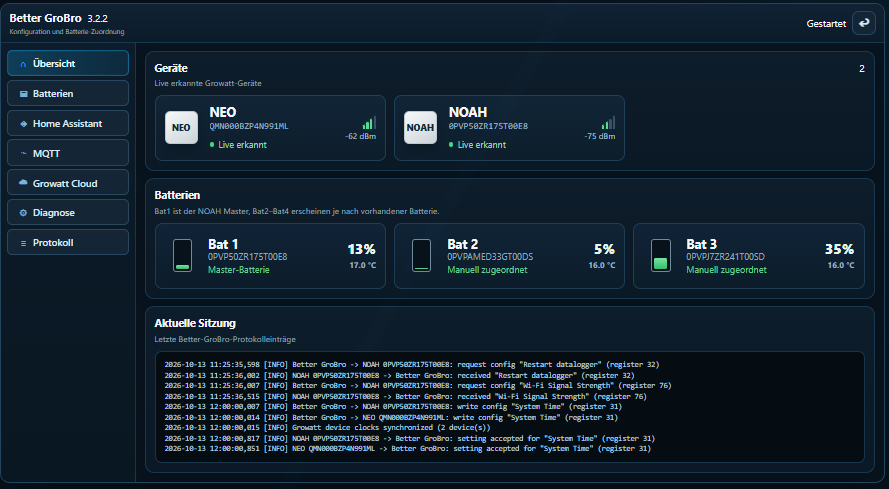

# Better GroBro

> **GroBro, optimized for Home Assistant.**

Better GroBro builds on [Robert Zaage's GroBro](https://github.com/robertzaage/GroBro) and adds a built-in Home Assistant interface, persistent battery assignments and practical tools for everyday operation.

## Your devices and batteries at a glance

*Built-in Home Assistant interface · Example overview in German*

- **See connected devices:** detected Growatt devices and their Wi-Fi signal strength in one overview.
- **Keep track of your batteries:** charge level, temperature and battery assignment together on one page.
- **Troubleshoot in place:** view the current-session log and access MQTT, Growatt Cloud and diagnostic settings from the sidebar.

---

## Better GroBro 3.3.51

**Neu in 3.3.51:** Alle experimentellen Rückleseverzögerungen für Geräte-Bedienelemente entfernt. `switch`, `select`, `number` und `time` verwenden wieder die ursprüngliche unmittelbare Rücklesung nach dem Schreibbefehl (Verhalten wie 3.3.44). Die zusätzlich eingeführte Timer-Verwaltung und vorübergehende Select-Diagnoseprotokollierung wurden zurückgenommen.

## Better GroBro 3.3.50

**Neu in 3.3.50:** Die erfolglose Verzögerung für `select` wurde zurückgenommen; Select-, Number- und Time-Befehle werden wie ursprünglich sofort zurückgelesen. Ein/Aus-Schalter (`switch`) bleiben bei 3 Sekunden. Neue gezielte INFO-Protokolle zeigen Zustandswechsel von Select-Entitäten, um die Quelle des Zurückspringens anhand echter Geräteantworten zu untersuchen.

## Better GroBro 3.3.49

**Neu in 3.3.49:** Rücklesung bei `select`-Auswahlfeldern nach 5 Sekunden, bei `switch`-Schaltern weiterhin nach 3 Sekunden. `number` und `time` werden weiterhin sofort zurückgelesen.

## Better GroBro 3.3.48

**Neu in 3.3.48:** Nur bei `switch`- und `select`-Einstellungen erfolgt die Kontrollabfrage 3 Sekunden nach dem Schreibbefehl. Für `number` und `time` ist die ursprüngliche sofortige Rücklesung wiederhergestellt. Messwert-Telemetrie bleibt unverändert.

## Better GroBro 3.3.47

**Neu in 3.3.47:** NOAH/NEXA-Zeitplanleistungen (`slot*_power`) werden wie andere schreibbare Einstellungen nach 3 Sekunden zurückgelesen. Der aktuelle Messwert `out_power` („Output Noah“) bleibt reine Telemetrie ohne zusätzliche Rücklesung.

## Better GroBro 3.3.46

**Neu in 3.3.46:** Kontrollabfragen nach Schalt- und Einstellbefehlen erfolgen nach 3 Sekunden statt sofort.

**Neu in 3.3.44:** Der Protokoll-Reiter bietet zusätzlich zum bisherigen Raw-MQTT-Download einen ZIP-Export aller noch vorhandenen Dump-Segmente (aktuell und bis zu drei Rotationsdateien). Die Geräte-, MQTT- und Cloud-Kommunikation bleibt unverändert.

### What Better GroBro offers

#### Easier Home Assistant setup

- Built-in configuration page directly inside Home Assistant, including MQTT settings and battery assignment
- Save settings and restart the add-on from the same interface
- Overview of detected devices, including their Growatt family and serial number
- Current-session add-on log viewer without leaving Better GroBro
- German, English, French, Spanish and Dutch interface and Home Assistant entity names, selected automatically from the Home Assistant language

#### Battery assignments that stay under your control

- Persistent NOAH Bat2/Bat3/Bat4 assignment by serial number when `KEEP_BATTERY_POSITION` is enabled, so a battery keeps its logical slot when the device reports a different physical order
- Optional manual Bat2/Bat3/Bat4 assignment by serial number in the built-in interface; your saved choices take priority over automatic assignment
- Saved assignments survive add-on restarts

#### More useful battery and firmware information

- NOAH Bat2/Bat3/Bat4 maximum and minimum cell-voltage sensors use the same Home Assistant metadata and scaling as Bat1
- NOAH Bat1–Bat4 cell-voltage sensors request three decimal places in Home Assistant, making millivolt differences easier to see
- Combined NOAH/NEXA firmware display includes the datalogger version when available, both in the firmware sensor and the Home Assistant device information
- Firmware changes refresh the Home Assistant device information automatically

#### More reliable everyday operation

- Growatt Cloud forwarding uses Robert Zaage's synchronous connection setup and direct MQTT forwarding, without an additional Better GroBro backlog

- Improved recovery of MQTT connections and Home Assistant discovery after restarts
- More reliable “Read All” handling when replies are missing or a connection is interrupted
- Devices become unavailable after the configured telemetry timeout, helping you recognize stale readings; their Home Assistant entities remain in place and become available again when data returns
- Repeated identical telemetry avoids unnecessary MQTT state publications, while changed readings are still published
- Automatic clock synchronization for supported devices twice a day
- Validation of NOAH/NEXA message lengths and register blocks before their readings are processed

#### Easier troubleshooting

- Clearer log entries identify source, target, device family, serial number and configuration register
- Optional passive register diagnostics for investigating device readings without sending additional device commands
- Diagnostic output can be limited to changed register values to reduce noise

### What stays familiar

Better GroBro keeps GroBro's MQTT bridge, Home Assistant discovery, supported device controls and optional Growatt Cloud forwarding. Local operation without cloud forwarding remains possible.

“Read All” and automatic battery-count detection remain part of the familiar feature set. The improvements described above retain existing Better GroBro entity identifiers and command topics, keeping dashboards and automations connected to their entities.

---

## Installation

Add this repository to the Home Assistant Add-on Store:

`https://github.com/criticallimit/GroBro`

Then install or update **Better GroBro**.

Existing Better GroBro settings are retained when updating the installed add-on.

---

## Credits

Better GroBro is based on [robertzaage/GroBro](https://github.com/robertzaage/GroBro) by Robert Zaage and contributors.

**Neu in 3.3.4:** Der aktuelle Batterieenergieinhalt wird mit zwei Nachkommastellen angezeigt.
